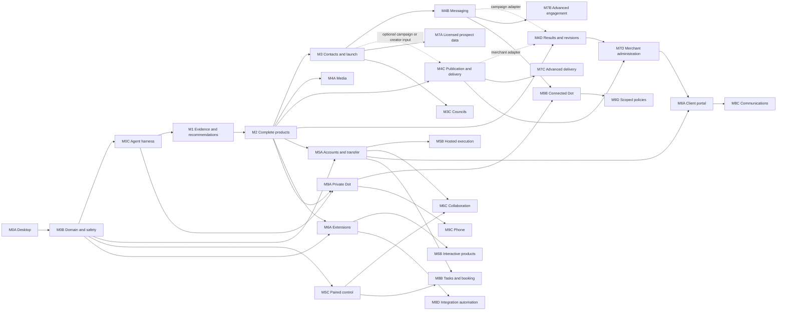

# Open Product Studio: canonical engineering roadmap

> **For agentic workers:** Implement work packages individually using the repository instructions, dependency contracts and independent reviewer assigned to the package. Keep the checkbox evidence in each package current.

**Goal:** Build one downloadable, open-source business studio that researches choices, creates useful digital products and supports their launch, delivery and improvement using explicitly selected AI connections.

**Architecture:** Fork pinned T3 Code; retain its Electron shell, familiar UI, provider model picker, authenticated client runtime and durable execution platform. Add a modular business domain and dashboard with immutable product versions, evidence, relationships, campaigns and distribution. All modules register together; their executable capabilities activate through tested releases.

**Stack:** Initially retain upstream Electron, React/TypeScript, Vite, TanStack Router, Tailwind/UI primitives, Node/Effect and SQLite pins. Add compatible RHF/Zod forms and restrained motion. Optional Clerk/Convex coordinates hosted business accounts; Convex remains the central hosted authority, private storage and coordination. It does not replace local operation.

**Spec:** [Service decisions](SERVICES.md), [project experience](PROJECT-EXPERIENCE.md), [Payments](PAYMENTS.md), [payment provider decisions](plans/2026-11-13-payment-provider-decisions.md), [Product](PRODUCT.md), [architecture](ARCHITECTURE.md), [recommendations](RECOMMENDATIONS.md), [platform boundaries](PLATFORM-BOUNDARIES.md), [security](SECURITY-MODEL.md), [upstream ownership](UPSTREAM.md), [CI](CI.md) and [launch](LAUNCH.md).

**Status:** Revision 5, progress updated 19 November 2026, with additive [first-result and service-flow decisions](plans/2026-11-13-first-result-and-service-flows.md) and [payment lifecycle decisions](PAYMENTS.md). The [execution and release decisions](plans/2026-11-18-execution-and-release-decisions.md) govern fork intake, Windows qualification, hosted command durability and launch evidence. WP01 and WP02 are in progress. The pinned Windows source build and an isolated Electron launch succeeded. Studio desktop profile and first-launch work has begun. Full WP01 qualification and installed-build acceptance remain pending. The first downstream import is commit `8d14fde6896b3636915e38849416e1fedbec4b6c`. The [baseline receipt](BASELINE.md) records the build and packaging checks. The earlier [twenty-task plan](plans/2026-11-12-open-product-studio.md) is superseded as an execution sequence. Dates below identify research/design, not delivery promises.

## Project categories and release order

The current Windows builder opens **Blank**, **Digital product** and **Video**. The roadmap adds **Clipper** as a fourth peer with a dedicated builder. WP03 persists the choice and reads older projects, WP08 provides navigation and a resumable builder, and WP11 supplies editable ideas and recommendations for each active decision. A Video project can begin with an empty brief. A Digital product project may later supply a reviewed asset for a video by choice. A Clipper project starts empty and takes a permitted recording through moment selection, framing, captions, review and local export. WP24 owns the separate M4A external-playback and reopen test for that flow. Document formats, templates and sales channels are independent of the starting category. [Clipper design and milestone gates](CLIPPER.md)

WP53 evaluates each tool's qualification and scope. WP09 runs the selected style's preparation checklist and records the result of each approved setup action. WP14 versions the storyboard and scene edits. WP17 supplies rights-aware media library references. M4A/WP24 qualifies bundled local render routes, including a path with supplied narration or captions. Optional provider calls have separate quotes and grants. A style requiring a third-party declarative extension or executable plugin waits for its specific WP39/WP40 qualification. These packages never block the built-in path. An independently qualified M4C social operation uses WP27 for destination checks and WP28 for explicit account-bound dispatch and reconciliation. Editing, review and local export work without connecting a social account. [Category and style catalog](roadmap/project-categories.json)

## Authority and traceability

Approved architecture/decision records govern implementation; the capability/work-package register implements those decisions. Dated research supplies evidence, not overriding instructions. Conflicts require a recorded decision and updates to dependent contracts. Preserve upstream dependency pins at baseline even where an earlier research report proposed a different stack.

Use immutable module IDs `mod.*`, capability IDs `cap.*`, work-package IDs `WP01` onward and external prerequisite IDs `E1` onward. Renames retain aliases. A capability has one owning work package and activation milestone; a larger feature may need several capabilities. Registry presence means discoverable design, not a shipped implementation. Public marketing must match the enabled build and tested platform.

The [work-package register](roadmap/work-packages.json) and [execution contracts](WORK-PACKAGES.md) carry dependencies, exact file seams, interfaces, acceptance checks, owners and reviewers. There are **66 planned work packages and 111 owned capabilities**. The [304-row coverage register](FEATURE-COVERAGE.md) preserves the original 286-row census plus 15 owner-requested harness/council/Dot requirements and three original service/proof-bundle/scenario requirements; its [machine-readable coverage](roadmap/feature-coverage.json) maps each row forward and each package back. All 66 packages await independent acceptance. Each package records the build and evidence needed to activate its capabilities.

## Global constraints

- Downloadable Electron is a first-milestone deliverable; Windows x64 is the initial verified target.
- Preserve familiar T3 chrome and exact provider/account/model/options. The main surface becomes a dashboard; optional conversations remain useful execution detail.
- Every module appears in the first dashboard. Unshipped actions name their release milestone; missing project input, connection, permission, budget and optional service entitlement have different explanations.
- Recommendations accompany every active decision: investigate, recommend, explain, accept, override and refresh. Novices can authorize bounded reversible private work; external send/publish/spend needs a concrete reviewed action.
- Local work needs no Studio account, subscription or service credits. CLI/API accounts, model licenses and hardware are independent requirements.
- No silent model fallback, fabricated evidence, infinite retry, hidden cloud transfer, fake progress or earnings guarantee.
- Use original workflows, copy and prompts. Preserve upstream MIT/third-party notices; private workbook/transcript/media research stays outside the public repository.
- A model, skill, page or tutorial cannot grant itself tools, change eligibility, raise budgets or authorize another actor.
- Software availability, project revision progress, provider permissions, business grants and optional cloud entitlement remain separate state machines.
- No public sale, signing identity, merchant account or funding URL is invented. Missing external prerequisites block only their affected capability.

## Milestones and release gates

Each gate names accountable roles; real people must fill them before acceptance. AI may implement and review evidence but cannot accept commercial or security risk on the maintainer's behalf. Public signing and hosted-service gates are distinct from private development tests.

| Milestone | Work packages and usable result | Mandatory acceptance |
| --- | --- | --- |
| M0A: isolated desktop | WP01-02: pinned fork, independent identity, packaged local launch | Synthetic clean install/restart; no upstream service/state collision; notices and resolved dependency inventory |
| M0B: trustworthy foundation | WP03-09: every module route, durable business commands, exact selection, grants/budgets, restore, guidance, tool confinement | Direct-RPC denials; duplicate/crash fixtures; model mismatch stop; restored database/assets; usable keyboard/320px/reduced-motion shell |
| M0C: agent harness | WP52-57: agent definitions/plans, every-route tool restrictions, delegation, typed replies/artifacts/outcomes, memory/wake contracts and inspector | Native bypass/graph/identity/reply/duplicate completion/stop/poisoned-memory fixtures; honest driver compatibility |
| M1: evidence and choices | WP10-13: evidence pipeline, all starting paths, short diagnostic with one route plus backup, stage recommendations, separately verified API/free/local connections | Source-support/contradiction/abstention evals; bounded first deliverable and optional editable 30-day recommendation plan/manual check-ins; stale/offline behavior; denied paid fallback; adapter-specific compatibility |
| M2: complete document production | WP14-17: editable guide, workbook, template kit, curriculum and action plan; QA, brand/library, six export types | Each family completes a real example; first reviewed sample/export with M3 disabled; edits survive regeneration; outside-app edit/read-back and portable restore/rights tests |
| M3: audience and launch preparation | WP18-22: contacts, creator analysis/transcription, partnership split scenarios, reusable job cards, bounded client service jobs and campaigns/proof bundles | Provenance/visibility/suppression checks; zero-sales/unknown/loss scenarios; deliverable/revision/handoff checks; exact sample/recipient/unsent pitch; zero external sends |
| M3C: councils | WP58-59: independent positions, challenge, synthesis/dissent, decision clinic and safe draft experiments | Peer isolation, quorum/reviewer/budget/timeout/model-identity checks; no council-granted side effects |
| M4A: generated media | WP23 image routes and WP24 standalone video builder with local and provider routes | A versioned style, editable timeline, inspected export and external-player reopen; qualified paid jobs have separate rights, cost and reconciliation checks |
| M4B: messaging execution | WP25-26: sender readiness, inbox lifecycle, approved sends/follow-ups | Reply/suppression races, gaps/cursors, bounce/complaint handling, DST, stop/revoke and unknown outcome fixtures |
| M4C: publishing and buyer access | WP27-28 destination qualification and approved social or listing publication; WP29-30 merchant events and buyer delivery | Prove publication on each authorized social account. Commerce separately verifies merchant, price, order and access. Manual handoff remains available where APIs are absent. |
| M4D: measured improvement | WP31-32: authorized results, experiments, proposed product revisions | Missing data remains unknown; currency/window semantics; duplicate imports; no unapproved publication |
| M5A: optional account and transfer | WP33-34: cloud workspace auth, explicit fenced transfer/backup | Tenant/parent isolation, failed-transfer recovery, old-writer rejection, local independence |
| M5B: optional hosted execution | WP35-37: Studio subscriptions/seats, prepaid service units, isolated API workers and operations | Payer-org checkout/portal/paid-through lifecycle; concurrent spend/refund; semantic payment dedupe/reorder/disputes; worker isolation; restore and economic gates |
| M5C: paired control | WP38: responsive remote control of a chosen host | Scoped challenge/replay/revocation tests; cross-version and sleeping-host behavior; no credential transfer |
| M6A: reviewed extensions | WP39-40: declarative extension distribution and isolated executable plugins | Publisher/version/scopes review; confinement, upgrade/revocation and removal tests |
| M6B: interactive products | WP41: sandboxed calculators, assessments and small interactive tools | Generated code cannot reach host authority; bounded builds, accessibility, safe export and usability review |
| M6C: collaborative editing | WP42: negotiated content merge and shared project roles | Concurrent-edit convergence, offline/conflict/revocation tests; money/grants/external actions stay serialized |
| M7A: licensed prospect data | WP43: searchable licensed company/person data, verification and enrichment | Account-specific API/credit/field coverage, bounded job/export and privacy fixtures; no cloned proprietary database |
| M7B: advanced engagement | WP44-45: unified replies/categories/attachments and optional sender provisioning | Exact reply approvals, suppression-safe reuse/OOO controls, ownership/cost/ramp and provider-specific admin tests |
| M7C: advanced delivery/storefront | WP46: provider-supported quizzes/drip/progress/resources/catalog | Independent learner access/lesson/store API tests; unsupported provider features disabled |
| M7D: merchant administration | WP47: refunds/plans/promotions, tax/share/invoice/payout projections and scenarios | Exact-money approvals, partial/refund/dispute/reconciliation, direct-versus-marketplace tax semantics |
| M8A: client portal/documents | WP48: scoped onboarding/resources, proposals, e-sign and invoice handoff | Cross-client isolation, real provider status/audit, recipient/action and document-version checks |
| M8B: tasks and booking | WP49: recurring tasks, workload, reminders and calendar operations | DST/dedup/privacy/role checks and provider-owned always-on behavior |
| M8C: communications/community | WP50: provider-connected chat/resources/calls/events and community | Per-capability participant/privacy/retention tests, explicit human moderation; no unverified encryption/calling claim |
| M8D: integration automation | WP51: versioned external API/MCP and bounded trigger/actions | Auth/schema/event/idempotency/loop/depth/budget/revoke fixtures; no self-authorizing automation |
| M9A: one private Dot | WP60-61: single identity, correctable memory, responsibilities, private research/drafts/digests | Owner/host fencing, quiet-hours/backlog/budget/forget/kill/restart tests; no external actions |
| M9B: Dot connections | WP62-64: AgentMail, dedicated browser and read-only Agent Reach, each independently enabled | Privacy/account/scopes, signature/backfill, no personal-cookie access, takeover/unknown-action recovery |
| M9C: Dot phone | WP65: provider-qualified voice/SMS for that same identity | Canonical provider/account/country, consent/recording/model/latency/stop/charges and replay tests |
| M9D: scoped unattended actions | WP66: optional narrow standing mail/browser policies and incident operations | Named recipient/action/data/time/cost/expiry, immediate revocation and remote-work inventory; phone stays per-call reviewed |

This introduces one complete design in stages, not a collection of unrelated future apps. Course *content authoring* belongs to M2; buyer enrollment/progress belongs to a selected external delivery service in M4C. A complete platform-owned learning-management service is not implied by a course document. Its addition would require its own approved work packages and operational commitment.

M7/M8 are explicit wider-ecosystem expansions, not a claim that the current challenge bundle includes every documented vendor feature. Their modules are registered from M0B with honest roadmap states. Beginner navigation shows relevant tasks and contextual connections; the full catalog stays discoverable without overwhelming the main task view. None of these extension gates requires us to operate a payment processor, lead database or real-time media network.

## Dependency graph and candidate critical chain

The direct local product-to-customer candidate chain is M0A/B/C → M1 → M2 → M4C → M4D. M3 supplies optional campaign/creator inputs; manual-feedback improvement can follow M2 without mail or commerce. Messaging, creator approvals and destination contracts become critical only for their selected actions. M4A is a dependency only when a publication actually uses generated assets. Councils and later Dot gates are separately enabled; ordinary recommendations do not require a council, and Dot does not require every cloud/client operation. The detailed package graph governs exact dependencies; the diagram groups related packages and is not a required screen-click order.

No duration-based critical path or calendar promise is justified yet. First timebox packaging, the transaction bridge, CLI/tool confinement and one destination capability spike. Estimate each package with optimistic/likely/pessimistic effort, testing/review effort, assumptions and external lead time. Recompute after observed throughput and rework. A solo maintainer cannot assume the throughput of a staffed platform team.

After the feature census, WP22 explicitly includes upsell assets tied to a configured additional offer, a fourteen-day story-launch template and prelaunch validation. WP43-51 own the broader vendor refinements. Alchemy of Self behavior and three hidden format names remain research gaps; no engineering package claims to reproduce unknown behavior. Human/private-course/promotion benefits have explicit non-software dispositions in the coverage register.

[Episode recovery](research/episodes.md) now supplies four full available mirror transcript bodies and timestamped design locators. It strengthens creator-conditioned authoring requirements and confirms the authoring wait was edited from the demonstration; it does not provide full after-hours, perfect speech coverage or an application performance benchmark.

The [final current-demo inspection](research/current-demos.md) strengthens WP15/19-21: editable observed/inferred creator analysis, separate family/subtype/depth configuration, coaching-offer authoring and version-bound creator-outline approval. Supplied licensed assets can support document subtypes at M2; automated media remains M4A. M3 may record externally received approval with evidence, while identity-verified remote collaborator approval requires M6C/M8A. The Ghostwriter montage informs interface requirements but cannot prove a current operational generation/save/export chain.

## Bounded contexts and interfaces

The [first-result/service design](plans/2026-11-13-first-result-and-service-flows.md) refines existing acceptance and introduces OPS-019/020/021 without new work packages or capability IDs. WP08/11 reuse brief fields; WP15/17 finish an M2 sample/export independently of M3. WP21 now depends on WP17 for service-job export, never the reverse. WP52/55/57 expose readable job contracts before M1; M3 adds their searchable composition. WP22 binds the sample, recipient and exact unsent message. WP20's deterministic split worksheet stays local proposal data, with no M6B generated-code or M7D accounting prerequisite. Generated media, sending, publishing, phone and client-service integrations retain their existing gates. The decision records original requirements and partial research limits, not additional verified source behavior.

The [agent harness](AGENT-HARNESS.md) is a mandatory shared foundation. `AgentDefinition`, `RunPlan`, `ToolEnvelope`, `ReplyContract`, `ArtifactRef` and `Outcome` add versioned behavior/authority/result contracts around native execution. The [design-only role registry](roadmap/agent-contracts.json) declares seven initial specialist/coordination roles and bounded reply requirements. It is not an executable runtime policy or a substitute for WP52-57 acceptance. Role prompts and hidden tools never confer authority; provider-native tools need separate enforcement qualification.

Councils are bounded harness workflows with isolated first positions, explicit review/quorum and preserved dissent. A later [single Dot](PROACTIVE-DOT.md) uses the same memory/event/host/authority model. Proactive research and private drafts precede external-action policies; channel signatures and incoming messages cannot impersonate owner approval.

Use a modular monolith on each execution host. `packages/studio-contracts/src/<context>.ts` owns validated wire/data schemas; `packages/studio-domain/src/contexts/<context>.ts` owns pure invariants and ports; `apps/server/src/studio/repositories/<context>.ts` implements local SQLite persistence. WP33 owns equivalent scoped cloud read/command ports in `apps/cloud/convex/studio/` for admitted project contexts. WP34 checks the transfer coverage matrix. WP36 runs the shared harness against the durable cloud job journal. UI lives in `apps/web/src/features/studio/`; bundled declarative workflows live in `modules/`. These are proposed paths until source import.

| Context | Sole write ownership | Consumers |
| --- | --- | --- |
| project | BusinessProject, audience/offer revisions, decisions, project progress | All modules via revisioned references |
| evidence | Sources, claims, access/rights, transcript segments, support links | Strategy, content, creators and recommendations |
| content | Immutable document/media versions, reusable brand, assets, exports | Previews, campaigns, publication |
| relationships | Scoped people/organizations, creator profiles, per-project visibility, suppressions | Creators and campaigns |
| engagement | Campaign/sequence versions, sender state, mailbox cursors/messages, dispatch | Distribution/insights and activity |
| distribution | Publications, destination mappings, merchant-event/order/buyer-access projections | Delivery and insights |
| insights | Metric definitions, feedback, experiments, revision proposals | Recommendations; never directly edits published content |
| execution | BusinessRun/native-run mapping, approvals, grants, reservations, operation intents | Broker, UI and all effectful modules |
| service billing (optional cloud) | BillingOrganization, payer customer/subscription, service entitlement/seats, service-unit ledger | Hosted eligibility/worker admission; never creator funds or local account-free use |

Workspace initially means a local ownership scope. Shared contact identity must not expose private notes across projects. A command has one aggregate owner. Cross-context updates use committed events and idempotent handlers; safety checks and local reservations deliberately join the owning command's transaction. Cloud service billing and external merchant money remain separate authorities.

`CommandEnvelope {commandId, projectId, capabilityId, expectedRevision, inputRefs, payload}` receives its actor/environment from authentication. Duplicate command/digest returns the original receipt; a changed digest conflicts. `commitStudio(command): CommandReceipt` validates authorization/eligibility/revision, changes owned state, appends business events, reserves budget and commits operation intent atomically. Recheck grants and eligibility immediately before dispatch.

Upstream `EventSink.ts`/`EffectWorker.ts` accept typed execution events, not arbitrary business state. WP04 deliberately adds one versioned `studio.execute` effect through the same injected transaction/outbox, then maps it to existing native execution in `studio/runtime-bridge.ts`. Publish after commit. Prove the shared transaction and post-crash classification before automated use; this hook does not exist in the pinned source. Ordinary business edits need neither a Git repo nor a chat thread. Preserve native provider completion versus artifact/checkpoint finalization.

Connector ports are `prepare(input): ActionPreview`, `dispatch(approvedAction, idempotencyKey): Receipt | Unknown`, and `reconcile(operation): Outcome`. Approval binds payload/version/recipients/destination, actor, expiry and price ceiling. Unknown outcomes stop blind retry; receipts distinguish accepted, dispatched, delivered, failed and unknown. External provider idempotency is verified per capability, never assumed from the local key.

## Durable data, offline behavior and migrations

Persist aggregate/version, actor, event/command IDs, causation/correlation, input hashes and schema version. Business provenance retention is independent of upstream transport-event pruning. Audit metadata avoids raw credentials and unnecessary personal content.

For assets, write bounded temporary bytes, verify/hash, atomically rename, then commit the reference. SQLite and filesystem are not one transaction. Recovery reclaims unreferenced assets only after a grace period. Backup captures a consistent DB snapshot and pins all referenced immutable blobs until manifest verification completes. Restore into a new directory, verify schema/hashes, and swap under the server ownership lock; reconcile outstanding external operations before resuming dispatch.

WP07 specifies migration checksums/journal, forward migrations, pre-upgrade snapshots, minimum reader/writer versions and interrupted-migration recovery. Installing an older binary must not silently downgrade its database. WP04 measures FULL durability for approval/dispatch-critical records, including performance and filesystem limitations. No claim of absolute protection against hardware failure follows from a SQLite pragma.

Proposed retention defaults to validate: local project data until deletion, redacted diagnostic logs 14 days, managed backup generations 30 days. Exported user backups and accounting/legal records have distinct disclosed rules. Current deletion/revocation state outside the rewound snapshot governs managed restore and transfer; retain necessary audit metadata rather than every historical personal payload. An unmanaged old archive without that journal requires historical content-only review, never automatic reactivation or a universal non-resurrection claim.

Offline editing, installed exports and inspection of cached evidence remain useful. Provider work queues with an explicit stale/offline state. A sleeping desktop is not an always-on inbox or buyer-delivery server. Provider-managed sequences must enforce reply/suppression stops themselves; otherwise an awake host and fresh sync are required. Webhook-only adapters need an authorized always-on receiver, never a public desktop execution endpoint.

## Exact providers, recommendations and skills

Retain upstream `{instanceId, model, options}` and descriptor-driven options. Record execution host, requested selection, catalog/adapter/CLI/workflow versions and reported effective identity on each run/child. Validate queued work again at dispatch. Preserve unavailable selections and explain the blocker. Provider reroutes stop dependent work; missing effective identity is marked unverified. Hosted aliases do not prove immutable model weights.

Codex discovery and each other driver's own contract remain authoritative. Sol xhigh and Astra high are supported requested policies only when discovered on that account; there is no universal effort dropdown. M1 official API, fixed free models, explicit free routing and local inference each have separate compatibility/terms/hardware gates. An explicit free router is a routing policy, not an exact-model pin. Disable paid fallback. Do not bundle consumer OAuth proxies or make a gateway mandatory.

Every stage's recommendation shows evidence, alternatives, tradeoffs, assumptions, cost limits and unresolved questions. Accept/override creates a decision revision. Relevant input edits mark dependent work stale without deleting historical completions. Scheduled refresh is opt-in, debounced, budgeted and host-dependent; 'continuous assistance' never means infinite background spending.

Start with existing Agent Reach, shared browser and primary-source tools; evaluate local ASR only for accessible, non-silent audio. [TOOLING.md](TOOLING.md) distinguishes skills, executables, hosted services and account authorization. A tool catalog cannot promise any data. Source/publisher/license/revision, credentials, destinations, cost, retention, failure and removal must be reviewed. M6 extensions cannot confer authority through downloaded instructions.

## Distribution, commerce and messaging

The [payment design](PAYMENTS.md) and [dated official provider decision](plans/2026-11-13-payment-provider-decisions.md) refine existing WP27-31, WP33-37 and WP46-48 without adding IDs or changing 66 packages/111 capabilities/304 rows. Studio BillingOrganization is separate from the active project, creator MerchantConnection and buyer identity; project switching cannot retarget checkout, a reservation or refund. Hosted auth is provider-neutral; the service/auth decision is maintained separately.

M4C selects an actual official destination before adapter coding. Its capability/API/sandbox matrix determines what is enabled. Listing publication, merchant-event ingestion and buyer fulfillment are separate work packages with separate receipts. A page-publish receipt is neither a sale nor proof of enrollment. Provider-native download, course and membership capabilities pass independent tests. Unsupported destinations receive an honest manual export/handoff, not a success toast.

Merchant remains authoritative for orders/refunds/tax and buyer financial state. Project data holds verified projections. Buyer access uses authenticated provider events plus reconciliation; refunds can revoke future access but cannot erase downloaded files. Customer delivery is destination-managed or an isolated public service. Creator revenue, platform AI credits, personal provider usage and partner compensation are four separate concepts. Native fund custody, merchant-of-record operations and partner payouts stay with selected external services/human operations. Propose a creator-owned approved Lemon Squeezy store for first original downloads, provider checkout/delivery and manual file/product setup where its API lacks writes; qualify Whop/course/membership separately. There is no Studio master store reselling others' products. Merchant onboarding, payout-bank/currency, product/AI-content approval and tax mode are verified E3 gates; M4C dashboard handoff precedes WP47 admin. Connect direct/destination/separate-charge and split operations remain disabled until an independently reviewed funds-flow, liability, country and reversal decision.

M4B requires inbox ingestion and sender readiness before follow-ups. Store provider message/thread IDs, history cursors, sent/replied/bounced/complained/unsubscribed states and gaps. Backfill safely, deduplicate events and pause on stale inbox state, replies, suppression, revocation or unsafe senders. Verify provider-reported SPF/DKIM/DMARC readiness, timezone/DST windows and daily/rate caps. Approval covers the exact campaign/recipient/payload version. No guarantee of deliverability or automatic mailbox/domain purchase follows.

Image/video quote expiry, failed-job charges and pending outcomes require reservations/reconciliation. Voice/likeness permissions are separate from analysis rights. ASR provenance records audio hash/duration, language, segments, tool/model revision and corrections; native captions, mirrors and inferred summaries remain distinguishable.

## Optional cloud, pairing and collaboration

M5A introduces Clerk identity with the official Convex integration and Convex business tenancy without changing local independence or upstream execution-environment auth. Every function checks identity, tenant/role, parent and object ownership. Project transfer freezes the source, verifies an immutable manifest, commits an ownership epoch and fences stale writers. Failure stays resumable/read-only. Copy creates a new ID; credentials, approvals and wallet authority never migrate as ordinary project content.

M5B uses commercially permitted APIs in isolated workers. WP35 owns Studio recurring service/seat subscriptions separately from prepaid inference/service units; neither is required for local CLI use or creator-owned external checkout. Stripe Checkout/Billing/portal is the conditional reference implementation under E4, ordinary processing with our merchant duties. Paddle needs separate full-offering/MoR approval; no silent provider switch. Payer-scoped server intents, allowlisted prices/currencies/tax/terms, verified payment/renewal/paid-through status and dispatch-time role/grant/reservation checks govern hosted access. Seat purchases cannot activate unshipped WP42 collaboration. No client success callback charges, grants units or buyer access.

The append-only service ledger reserves/settles exact units atomically; it is not money, a third-party payment method or withdrawable wallet. Refund freezes, concurrent spends, semantic dedupe beyond event IDs, provider-specific signatures, stale/reordered state, consumed-unit chargebacks, reconciliation and fenced restoration are release gates. Purchased unused packs initially propose no expiry; refund and promo rules require E4 approval and mandatory-rights review. Cancellation preserves completed exports and remaining eligible packs. The USD 19.95 service-pack denomination remains an economic experiment after measured API/retry/media/infrastructure/payment/tax/FX/support/dispute costs and unconsumed service obligations, never unlimited usage or a subscription price promise.

M5C can control a local host without a cloud wallet. Pairing grants have bounded project/action scope, expiry, replay resistance and explicit revocation. An asleep host is unavailable; the phone never receives raw CLI credentials. A native mobile app needs a separate scoped commitment.

M6C negotiates document merge/CRDT semantics only for editable content with a tested convergence policy. Money, permissions, approvals and external writes remain serialized authoritative commands. Adding 'sync' to a database choice does not solve product conflicts or access control.

## External prerequisites and human responsibilities

| ID / accountable role | Before activation | Required decision/evidence |
| --- | --- | --- |
| E1 release owner | Public desktop binaries | Cleared identity/domain, signing and update feed, vulnerability contact, release approval; private unsigned tests may proceed |
| E2 connector owner | Affected research/media/messaging/delivery capability | Source rights, account, supported API/scopes, quotas, country eligibility, bounded sandbox/live-test budget and always-on ingress if needed |
| E3 creator/business owner | Merchant/delivery integration | Seller entity/country/product/AI-content approval, payout-bank/currency, merchant/destination/mode, actual processor/MoR/tax/refund/dispute duties; supported checkout/delivery and any split/Connect liability review |
| E4 finance/service owner | Pre-build decisions; separately public paid activation | Studio seller entity/country/full-product approval, licensed commercial APIs, processor/MoR duties, prices/tax/invoices/refunds/disputes/cancellation/retention, cash-loss reserve and measured service obligations/economics; test mode is not live eligibility |
| E5 maintainer | Donation links | Verified funding URLs, payout eligibility and fees; no invented account or access tied to donations |
| E6 rights/domain reviewer | Affected analysis/publication | Creator analysis/transformation/redistribution permissions, specialist approval, likeness rights; human support/coaching/moderation responsibilities |
| E7 platform owner | Added OS/native mobile support | Device/runtime acceptance matrix, packaging/signing/update and maintenance commitment |

Some advertised benefits are services, databases or third-party entitlements. The original software can provide workflows and connectors, not reproduce private lead inventories, coaching labor, guaranteed sales, provider credits or marketplace distribution by drawing a matching screen.

## Quality, CI, release and maintenance

Every work package carries deterministic checks, security/accessibility consequences, evidence artifacts and independent acceptance. Keep upstream checks and add `studio:test`/`studio:e2e` only with real suites. Use fake providers, synthetic inbox/merchant events and fixed original content fixtures in ordinary PR CI. Live paid/account checks run against trusted revisions under a separate budget. Source text and PR content remain untrusted to the AI reviewer.

Starting evidence rubric for `evals/studio/v1`: zero invented source IDs; every locator resolvable; at least 95% directly supported factual claims across a human-labeled sample of at least 30 claims spanning five project scenarios; abstain on every seeded insufficient-evidence case. These are proposed release thresholds, not general accuracy guarantees. Freeze the dataset/rubric before runs, record disagreements and compare workflow/provider-version changes. Independently score product correctness, usefulness, specificity, originality/rights and completeness; no failing dimension may pass on average prose quality.

Test keyboard, 320px, zoom, reduced motion and representative screen readers; preserve readable error/recovery states. Four of five novice pilot participants completing the defined journey is an initial product gate, not statistical proof. Set device/performance budgets after baseline measurement and retain regression profiles. A sleek animation does not compensate for lost drafts or uncertain sends.

Before a public enabled capability: all its safety/authorization fixtures pass, no unresolved high/critical issue, signed/provenance-checked packaging where applicable, restore/revocation evidence, current notices and an accountable release owner. AI review is advisory until benchmarked; it receives bounded untrusted diff data without shell/secrets/write authority. Hosting rules protect workflow/policy changes separately.

Upstream owner triages weekly, expedites security changes and integrates reviewed batches in staging. Record base/downstream/schema/catalog revisions, native binaries, resolved staged dependency graphs, SBOM/notices and artifact hashes. Preserve protocol drift tests and test interrupted update/restore. Re-estimate work after each accepted gate; no final 'polish/security week' replaces checks embedded in every package.

## Review focus

1. A stale catalog, helper or retry silently changes the user's selected model: pin at every dispatch and stop dependent work on mismatch (WP05, WP11-13).
2. Process loss separates a reservation/approval from execution intent: one transaction/outbox, process-loss fixtures and unknown-outcome reconciliation (WP04, WP06-07, WP26, WP28-30, WP35-37).
3. Untrusted content or generated code gains host/cloud authority: typed broker, parser/preview isolation and distinct executable sandbox gates (WP09, WP14, WP39-41).
4. Project transfer/restore enables two writers or repeats an old external action: ownership epochs, compatible restore and fresh reconciliation (WP07, WP34, WP38, WP42).
5. A publication, payment event or email receipt is mistaken for successful buyer access or business results: separate state machines, provider history and explicit missing data (WP25-32).

## Evidence order and conditional dependencies

The register now attributes every acceptance item to component, integration or public-release evidence and named producers. All entries remain `not-run`. Component acceptance establishes an interface; activation needs every applicable integration/release record and external gate for the exact build/action. `accepted` package status must not be used as a feature-availability flag. Later evidence can stay pending without inventing a pass or adding a reverse dependency.

WP02 accepts isolated development packaging/upstream-schema fixtures first; WP07 later supplies populated Studio upgrade/restore evidence, and E1 supplies signed promotion before public release. E4 pre-build evidence covers rights, proposed provider/terms and bounded synthetic or explicitly authorized non-public pilot budgets. WP35/36 component fixtures precede WP37's measured economics/operations. Public paid checkout/dispatch remains closed until that later evidence and actual commercial approvals pass. Use a synthetic evidence-order ledger to prove both development progress and denial of premature activation.

Dependency corrections: WP22 no longer requires WP20 for every campaign; creator-backed inputs still require its rights/approval contract. WP27 consumes reviewed product/offer ports directly; WP22 applies to campaign-derived listing input and WP20 to creator-backed rights. WP31 uses WP14's revisioned content foundation and manual observations; WP26, WP29 and WP30 are conditional campaign/order/delivery input adapters. WP32 can therefore accept manual feedback with M4B disabled. E3 is retained but inapplicable to WP20 hypothetical local arithmetic; E2/E3 apply to WP31 only for the affected external/financial input. No creator, email, commerce or feedback scope is removed.

SERVICES and PROJECT-EXPERIENCE assign transfer custody, authenticated lapse/exit, current deletion journals, exact connector account routing, first-activation operations, qualification expiry, navigation-aware authenticated browser safety and exported-document accessibility to existing packages. R2/Composio and extra infrastructure remain conditional choices. These are future runtime/independent-review requirements, not implemented guarantees; all 66 packages, 111 capabilities and 304 coverage rows remain in scope.

The register’s `allowsDependencyOn` partial order constrains cross-milestone edges. It describes permitted dependencies. Each user journey needs only its actual packages, enabled adapters and applicable external gates. WP05 and WP06 test early qualification/custody ports in isolation. Their driver and transfer integrations have later evidence producers. WP34 additionally selects custody tests per participating capability through `conditionalProducers`. The [execution and release decisions](plans/2026-11-18-execution-and-release-decisions.md) specify the evidence for each affected milestone.
